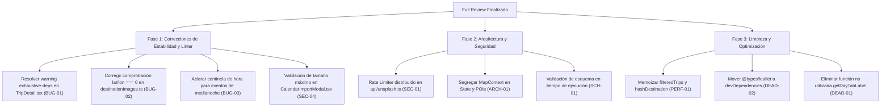

# 📋 Reporte de Auditoría Integral de Código Fuente — Roamly

**Proyecto:** Roamly (`~/Developer/Roamly`)  
**Stack Tecnológico:** React 19.2, TypeScript 6.0, Vite 8, Tailwind CSS v3/v4, Leaflet / React-Leaflet, Radix UI, Astro 7 (Landing)  
**Fecha de Auditoría:** 24 de Agosto, 2026  
**Alcance (Scope):** Código Fuente Completo (`src/`, `api/`, `landing/`, build scripts, linter y suite de pruebas)  
**Clasificación de Severidad Real:** `CRITICAL`, `HIGH`, `MEDIUM`, `LOW`

---

## 📊 1. Resumen Ejecutivo (Executive Summary)

Se ha realizado una auditoría técnica exhaustiva (**FULL REVIEW**) sobre el código fuente de **Roamly**, analizando las siguientes 5 dimensiones críticas del sistema:

1. 🔒 **Seguridad (Security)**: Aislamiento de credenciales (`UNSPLASH_ACCESS_KEY`), mitigación de abusos en Edge Proxy, sanitización de inputs externos (.ics, URLs, geocodificación), CSP y persistencia local.
2. 💎 **Calidad de Código y Bugs (Code Quality & Logic)**: Tipado estricto en TypeScript, linter rules de React 19 (`exhaustive-deps`), manejo de errores asíncronos y robustez ante fallos transitorios.
3. 📐 **Arquitectura y Patrones (Architecture & Structure)**: Desacoplamiento de persistencia (Repository Pattern), granularidad y segregación de Contextos React, sincronización multi-pestaña y orquestación en capas.
4. ⚡ **Rendimiento y Reactividad (Performance & Rendering)**: Ciclo de vida y diffing de marcadores Leaflet, memoización de listas y hashing, debouncing de red y bundle splitting con Rollup.
5. 🗄️ **Deuda Técnica, Esquema y Persistencia (Tech Debt & Schema)**: Validación en runtime de `localStorage`, versionado de esquema, categorización de dependencias y convivencia de tooling.

### Diagnóstico de Estado de Línea Base
- **Pruebas Unitarias (`vitest run`):** 🟢 **58/58 tests pasando (100%)** en 5 suites (`dates`, `geocoding`, `icsExport`, `icsParser`, `repository`).
- **Linter (`eslint .`):** 🟡 **0 errores, 1 advertencia** en [`src/pages/TripDetail.tsx:L80`](file:///Users/eduardotorres/Developer/Roamly/src/pages/TripDetail.tsx#L80) (`react-hooks/exhaustive-deps`).
- **Compilador TypeScript (`tsc -b`):** 🟢 **0 errores de tipos** en modo estricto con `erasableSyntaxOnly: true`.
- **Build de Producción (`vite build` + `astro build`):** 🟢 **Compilación exitosa** tanto para la SPA como para la Landing Page en Astro.

---

## 📊 2. Matriz Consolidada de Severidad Real

| Dimensión Evaluada | CRITICAL 🔴 | HIGH 🟠 | MEDIUM 🟡 | LOW 🟢 | Total Hallazgos | Estado General |
| :--- | :---: | :---: | :---: | :---: | :---: | :---: |
| 1. 🔒 **Seguridad** | 0 | 1 | 2 | 2 | **5** | 🟡 REVISIÓN |
| 2. 🐛 **Bugs y Lógica** | 0 | 0 | 3 | 2 | **5** | 🟢 ESTABLE |
| 3. 📐 **Arquitectura** | 0 | 1 | 2 | 1 | **4** | 🟡 REVISIÓN |
| 4. ⚡ **Rendimiento** | 0 | 0 | 1 | 2 | **3** | 🟢 ÓPTIMO |
| 5. 🧹 **Dead Code / Smells** | 0 | 0 | 0 | 3 | **3** | 🟢 BUENO |
| 6. 🗄️ **Schema / Persistencia** | 0 | 1 | 1 | 1 | **3** | 🟡 REVISIÓN |
| **TOTAL CONSOLIDADO** | **0** | **3** | **9** | **11** | **23** | 🟡 **SALUDABLE CON MEJORAS** |

---

## 🔍 3. Detalle Exhaustivo de Hallazgos por Dimensión

---

### 1. 🔒 Seguridad (Security)

#### 🟠 [HIGH] SEC-01: Rate Limiting en Memoria Volátil de Instancia Edge (`api/unsplash.ts`)
- **Archivo:** [`api/unsplash.ts:L37-L70, L246-L256`](file:///Users/eduardotorres/Developer/Roamly/api/unsplash.ts#L37-L70)
- **Diagnóstico:**
  El control de tasa (*token bucket*) se almacena en memoria local de la instancia mediante `const buckets = new Map()`. En entornos Serverless / Edge (Vercel Edge Functions, Cloudflare Workers, Netlify Edge), las instancias se ejecutan en cientos de nodos efímeros no coordinados. Un atacante puede distribuir peticiones HTTP entre diferentes nodos para evadir el límite de 20 req/min y agotar la cuota de la clave `UNSPLASH_ACCESS_KEY`.
- **Impacto:** Posible denegación de servicio por agotamiento de cuota de API upstream de Unsplash (50 req/hr en demo o 5,000 en prod).
- **Remediación:**
  Integrar un almacenamiento distribuido para rate limiting en el Edge (ej. Upstash Redis / Vercel KV / Cloudflare Rate Limiting API):
  ```typescript
  import { Ratelimit } from '@upstash/ratelimit'
  import { Redis } from '@upstash/redis'
  const ratelimit = new Ratelimit({
    redis: Redis.fromEnv(),
    limiter: Ratelimit.slidingWindow(20, '1 m'),
  })
  ```

#### 🟡 [MEDIUM] SEC-02: Persistencia en Texto Plano en `localStorage` sin Integridad Criptográfica
- **Archivo:** [`src/repository/TripRepository.ts:L66-L93`](file:///Users/eduardotorres/Developer/Roamly/src/repository/TripRepository.ts#L66-L93)
- **Diagnóstico:** Los itinerarios completos (fechas, hoteles, códigos de vuelo, notas personales) se almacenan en texto plano en `window.localStorage.getItem('wanderplan-trips')`.
- **Impacto:** Si bien es el estándar en arquitecturas cliente sin autenticación remota, cualquier script inyectado mediante extensiones de navegador con acceso al origen o vulnerabilidades XSS en el mismo dominio puede leer la totalidad de los datos de viaje del usuario.
- **Remediación:** Proveer una capa de cifrado simétrico opcional basada en Web Crypto API (`crypto.subtle`) para usuarios que deseen proteger sus notas locales mediante contraseña o PIN maestro.

#### 🟡 [MEDIUM] SEC-03: Inyección de Formato Markdown en Exportación de Itinerarios (`itineraryMarkdown.ts`)
- **Archivo:** [`src/utils/itineraryMarkdown.ts:L28-L37`](file:///Users/eduardotorres/Developer/Roamly/src/utils/itineraryMarkdown.ts#L28-L37)
- **Diagnóstico:** Aunque `icsParser.ts` sanitiza la descripción en la importación, los títulos ingresados manualmente por el usuario no se escapan al generar el Markdown de exportación. Si el título contiene caracteres de control de Markdown (ej. `[Enlace](javascript:...)` o ``), pueden alterar la estructura o insertar enlaces engañosos al exportar/compartir el documento.
- **Impacto:** Formateo roto o inyección de enlaces en visualizadores de Markdown externos.
- **Remediación:** Escapar caracteres especiales de Markdown (`[`, `]`, `(`, `)`) en `generateItineraryMarkdown`:
  ```typescript
  function escapeMarkdown(text: string): string {
    return text.replace(/[[\]()]/g, '\\$&')
  }
  ```

#### 🟢 [LOW] SEC-04: Ausencia de Validación de Tamaño Máximo de Archivo en Importador ICS
- **Archivo:** [`src/components/modals/CalendarImportModal.tsx:L123-L135`](file:///Users/eduardotorres/Developer/Roamly/src/components/modals/CalendarImportModal.tsx#L123-L135)
- **Diagnóstico:** `handleFile(file)` ejecuta `await file.text()` sin validar `file.size`.
- **Impacto:** Cargar un archivo extremadamente grande (>30 MB) congelará el hilo principal del navegador durante el parseo de cadenas.
- **Remediación:**
  ```typescript
  if (file.size > 5 * 1024 * 1024) {
    setError('File is too large. Maximum supported calendar size is 5 MB.')
    return
  }
  ```

#### 🟢 [LOW] SEC-05: CSP Estricta con Posible Conflicto en Proxies Externos
- **Archivo:** [`index.html:L12-L15`](file:///Users/eduardotorres/Developer/Roamly/index.html#L12-L15)
- **Diagnóstico:** La directiva `connect-src` permite `'self' https://nominatim.openstreetmap.org https://overpass-api.de`. Si se despliega el proxy Unsplash en un dominio externo mediante `VITE_UNSPLASH_PROXY_URL=https://api.external.com`, la llamada será bloqueada.
- **Remediación:** Documentar en `.env.example` que los proxies cross-domain requieren actualizar `connect-src` en `index.html`.

---

### 2. 🐛 Bugs y Errores de Lógica (Bugs & Runtime Logic)

#### 🟡 [MEDIUM] BUG-01: Advertencia de Linter y Concurrencia de Estado en `TripDetail.tsx`
- **Archivo:** [`src/pages/TripDetail.tsx:L73-L80, L90-L92`](file:///Users/eduardotorres/Developer/Roamly/src/pages/TripDetail.tsx#L73-L80)
- **Diagnóstico:**
  1. `useEffect` depende únicamente de `[tripId]`, pero utiliza `trip?.days[0]?.id` sin incluir `trip?.days` en el array de dependencias (`react-hooks/exhaustive-deps`).
  2. `setSelectedDayId` se invoca tanto dentro del `useEffect` como en el cuerpo del render (`L90-L92`) para resetear días huérfanos, lo que genera renders duplicados en React 19.
- **Impacto:** Genera advertencia de compilación ESLint y causa hasta 2 ciclos de re-render adicionales al cambiar entre viajes.
- **Remediación:** Consolidar la selección del día activo derivando el estado o sincronizando limpiamente:
  ```typescript
  const currentDayId = trip?.days.some(d => d.id === selectedDayId) 
    ? selectedDayId 
    : (trip?.days[0]?.id ?? '')
  ```

#### 🟡 [MEDIUM] BUG-02: Comprobación Defectuosa de Coordenadas Cero (`destinationImages.ts`)
- **Archivo:** [`src/utils/destinationImages.ts:L97`](file:///Users/eduardotorres/Developer/Roamly/src/utils/destinationImages.ts#L97)
- **Diagnóstico:** La comprobación `if (!result.lat || !result.lon)` evalúa como *truthy* si `lat === 0` (Ecuador) o `lon === 0` (Meridiano de Greenwich), dado que `0` es falsy en JavaScript. Esto dispara innecesariamente la llamada a `geocodePlace()` de respaldo en ubicaciones con coordenada 0.
- **Impacto:** Consultas redundantes a Nominatim y sobreescritura de coordenadas válidas devueltas por Unsplash.
- **Remediación:** Cambiar la condición a `if (result.lat == null || result.lon == null)`.

#### 🟡 [MEDIUM] BUG-03: Ambigüedad Semántica con Eventos a Medianoche ("00:00" vs "Sin Hora")
- **Archivos:** [`src/types/index.ts:L24-L26`](file:///Users/eduardotorres/Developer/Roamly/src/types/index.ts#L24-L26), [`src/components/trip/ActivityItem.tsx:L36-L43`](file:///Users/eduardotorres/Developer/Roamly/src/components/trip/ActivityItem.tsx#L36-L43), [`src/utils/icsExport.ts:L203`](file:///Users/eduardotorres/Developer/Roamly/src/utils/icsExport.ts#L203)
- **Diagnóstico:** `Activity.startTime` se tipa como `string` y el valor por defecto de eventos sin hora es `"00:00"`. Los componentes asumen que `"00:00"` representa un evento "untimed".
- **Impacto:** Si un usuario crea una actividad que ocurre genuinamente a las 00:00 (ej. "Vuelo nocturno 00:00" o "Celebración Año Nuevo"), la aplicación la trata como sin hora, ocultando el horario en la UI y exportándola como evento de todo el día en el archivo `.ics`.
- **Remediación:** Permitir `startTime?: string` (o usar string vacío `""` como centinela explícito de untimed) y reservar `"00:00"` para la medianoche real.

#### 🟢 [LOW] BUG-04: Manejo Silencioso de Errores en Portapapeles y Descarga (`TripDetail.tsx`)
- **Archivo:** [`src/pages/TripDetail.tsx:L159-L181`](file:///Users/eduardotorres/Developer/Roamly/src/pages/TripDetail.tsx#L159-L181)
- **Diagnóstico:** Los bloques `catch` en `handleExport` y `handleExportCalendar` están vacíos.
- **Impacto:** Si el acceso al portapapeles es denegado o falla por contexto no seguro (HTTP), el usuario no recibe ninguna notificación de error.
- **Remediación:** Mostrar un estado visual o toast de error cuando la promesa sea rechazada.

#### 🟢 [LOW] BUG-05: Concatenación de Query Params con Posible Duplicación en Unsplash Proxy
- **Archivo:** [`api/unsplash.ts:L282`](file:///Users/eduardotorres/Developer/Roamly/api/unsplash.ts#L282)
- **Diagnóstico:** `url: data.urls.regular + '&w=1920&q=85'` asume que `data.urls.regular` contiene ya un `?` y no contiene parámetros `w` o `q`.
- **Impacto:** Duplicación de parámetros en la URL final.
- **Remediación:** Usar `URL` / `URLSearchParams` para mutar parámetros de tamaño y calidad.

---

### 3. 📐 Arquitectura y Patrones (Architecture & Structure)

#### 🟠 [HIGH] ARCH-01: Monolito de Estado en `MapContext` Generando Re-renders Innecesarios
- **Archivo:** [`src/context/MapContext.tsx:L40-L130`](file:///Users/eduardotorres/Developer/Roamly/src/context/MapContext.tsx#L40-L130)
- **Diagnóstico:** `MapContext` agrupa tanto el estado de la UI del mapa (`mapExpanded`), marcadores (`markers`), animación (`flyToTarget`), como las recomendaciones POI de Overpass (`recommendations`, `isLoadingRecs`).
- **Impacto:** Cada vez que el usuario hace clic en un marcador y se inicia la búsqueda de lugares cercanos en Overpass, `MapContext.Provider` emite un nuevo objeto `value`, forzando el re-render de componentes de alto nivel como `MacOSMenuBar`, `Dashboard` y `AppShell`.
- **Remediación:** Segregar `MapContext` en sub-contextos especializados:
  - `MapStateContext`: `mapExpanded`, `markers`, `focusedMarkerId`
  - `MapDispatchContext`: `setMapExpanded`, `focusMarker`, `flyTo`, `clearFocus`
  - `MapPOIContext`: `recommendations`, `isLoadingRecs`

#### 🟡 [MEDIUM] ARCH-02: Interfaz Sincrónica en `TripRepository` Limita Migración a Backends Asíncronos
- **Archivo:** [`src/repository/TripRepository.ts:L13-L22`](file:///Users/eduardotorres/Developer/Roamly/src/repository/TripRepository.ts#L13-L22)
- **Diagnóstico:** La interfaz `TripRepository` define métodos 100% síncronos (`getAll(): Trip[]`, `save(trip: Trip): void`).
- **Impacto:** Para soportar almacenamiento asíncrono no bloqueante (IndexedDB, SQLite con OPFS, Supabase, Cloudflare D1 o Firebase), se requerirá refactorizar todos los hooks y componentes consumidores a llamadas asíncronas con promesas.
- **Remediación:** Definir una interfaz `AsyncTripRepository` o encapsular el acceso mediante `Suspense` y recursos asíncronos de React 19 (`use()`).

#### 🟡 [MEDIUM] ARCH-03: Alta Densidad de Lógica de Negocio y Red en Modales
- **Archivos:** [`src/components/modals/AddTripModal.tsx`](file:///Users/eduardotorres/Developer/Roamly/src/components/modals/AddTripModal.tsx) y [`src/components/modals/CalendarImportModal.tsx`](file:///Users/eduardotorres/Developer/Roamly/src/components/modals/CalendarImportModal.tsx)
- **Diagnóstico:** Los componentes de modales orquestan directamente controladores de aborto, debouncing manual, parseo de archivos ICS y llamadas a Unsplash y Nominatim.
- **Remediación:** Extraer la lógica a custom hooks (`useDestinationPreview`, `useCalendarImport`) para separar la capa de presentación de la capa de orquestación de datos.

#### 🟢 [LOW] ARCH-04: Convivencia Monorepo de Tailwind v3 y Tailwind v4
- **Archivos:** [`package.json`](file:///Users/eduardotorres/Developer/Roamly/package.json) vs [`landing/package.json`](file:///Users/eduardotorres/Developer/Roamly/landing/package.json)
- **Diagnóstico:** La SPA utiliza Tailwind CSS v3.4.19 con `tailwind.config.js` y PostCSS, mientras que la Landing utiliza Tailwind v4.3.3 con `@tailwindcss/vite`.
- **Evaluación:** **Estrategia funcional pero asimétrica.** Requiere mantener dos sistemas de tokens de diseño en paralelo.

---

### 4. ⚡ Rendimiento y Reactividad (Performance & Rendering)

#### 🟡 [MEDIUM] PERF-01: Recálculo en Cada Render en `Dashboard.tsx` y `TripCard.tsx`
- **Archivos:** [`src/pages/Dashboard.tsx:L135-L138`](file:///Users/eduardotorres/Developer/Roamly/src/pages/Dashboard.tsx#L135-L138) y [`src/components/dashboard/TripCard.tsx:L26-L47`](file:///Users/eduardotorres/Developer/Roamly/src/components/dashboard/TripCard.tsx#L26-L47)
- **Diagnóstico:**
  1. En `Dashboard.tsx`, el filtrado `filteredTrips = query ? trips.filter(...) : trips` se recalcula en cada render.
  2. En `TripCard.tsx`, `hashDestination(trip.destination)` calcula la suma de caracteres en cada ciclo de render.
- **Remediación:** Envolver `filteredTrips` y el cálculo de gradiente en `useMemo`.

#### 🟢 [LOW] PERF-02: Micro-optimización de Fechas en CalendarWidget
- **Archivo:** [`src/pages/Dashboard.tsx:L65`](file:///Users/eduardotorres/Developer/Roamly/src/pages/Dashboard.tsx#L65)
- **Diagnóstico:** En `CalendarWidget`, la iteración sobre las celdas del mes evalúa `day === today.getDate() && month === today.getMonth() && year === today.getFullYear()` en cada elemento.
- **Remediación:** Precalcular el día de hoy antes del mapeo de celdas.

#### 🟢 [LOW] PERF-03: Ausencia de Virtualización en Itinerarios Masivos
- **Archivos:** [`src/components/trip/ActivityTimeline.tsx`](file:///Users/eduardotorres/Developer/Roamly/src/components/trip/ActivityTimeline.tsx), [`src/components/map/NearbyPanel.tsx`](file:///Users/eduardotorres/Developer/Roamly/src/components/map/NearbyPanel.tsx)
- **Diagnóstico:** Se renderizan todos los elementos del DOM simultáneamente. Para viajes estándar (5-20 actividades/día) el impacto es nulo, pero calendarios masivos (>100 actividades/día) se beneficiarían de virtualización con `@tanstack/react-virtual`.

---

### 5. 🧹 Código Muerto y Deuda Técnica (Dead Code & Smells)

#### 🟢 [LOW] DEAD-01: Función Exportada No Utilizada (`getDayTabLabel`)
- **Archivo:** [`src/utils/dates.ts:L119-L121`](file:///Users/eduardotorres/Developer/Roamly/src/utils/dates.ts#L119-L121)
- **Diagnóstico:** `getDayTabLabel` se exporta en `dates.ts` pero no es invocada por ningún componente del proyecto (en `DayTabs.tsx` se usan `getDayLabel` y `formatDate` por separado).
- **Remediación:** Eliminar `getDayTabLabel` o integrarla directamente en `DayTabs.tsx`.

#### 🟢 [LOW] DEAD-02: Dependencias Mal Categorizadas en `package.json`
- **Archivo:** [`package.json:L17, L42`](file:///Users/eduardotorres/Developer/Roamly/package.json#L17)
- **Diagnóstico:**
  1. `@types/leaflet` está clasificado en `dependencies` en vez de `devDependencies`.
  2. `tailwindcss-animate` está en `devDependencies` pero no está configurado en `tailwind.config.js`.
- **Remediación:** Mover `@types/leaflet` a `devDependencies` y remover o configurar `tailwindcss-animate`.

#### 🟢 [LOW] DEAD-03: Duplicación de Interfaces de Respuesta de Imagen
- **Archivos:** [`api/unsplash.ts:L18-L24`](file:///Users/eduardotorres/Developer/Roamly/api/unsplash.ts#L18-L24) vs [`src/utils/destinationImages.ts:L33-L42`](file:///Users/eduardotorres/Developer/Roamly/src/utils/destinationImages.ts#L33-L42)
- **Diagnóstico:** `DestinationImage` y `UnsplashResult` definen la misma estructura de datos de forma redundante en frontend y backend.
- **Remediación:** Centralizar en `src/types/index.ts` o un paquete de contratos compartido.

---

### 6. 🗄️ Esquema de Datos y Persistencia (Schema & Consistency)

#### 🟠 [HIGH] SCH-01: Ausencia de Validación de Esquema en Tiempo de Ejecución en `localStorage`
- **Archivo:** [`src/repository/TripRepository.ts:L78-L85`](file:///Users/eduardotorres/Developer/Roamly/src/repository/TripRepository.ts#L78-L85)
- **Diagnóstico:** `read()` ejecuta `JSON.parse(raw) as Trip[]` con un type-cast estático. Si los datos almacenados carecen de campos obligatorios (ej. `days` no es un array o está corrupto), el fallo ocurrirá más adelante durante el renderizado en componentes React.
- **Impacto:** Fallos no controlados en tiempo de ejecución ante datos malformados en `localStorage`.
- **Remediación:** Incorporar validación liviana de estructura:
  ```typescript
  function isTripArray(obj: unknown): obj is Trip[] {
    return Array.isArray(obj) && obj.every(t => typeof t?.id === 'string' && Array.isArray(t?.days))
  }
  ```

#### 🟡 [MEDIUM] SCH-02: Ausencia de Control de Versión de Esquema (`schemaVersion`)
- **Archivo:** [`src/types/index.ts:L55-L73`](file:///Users/eduardotorres/Developer/Roamly/src/types/index.ts#L55-L73)
- **Diagnóstico:** La estructura de datos no almacena un número de versión de esquema (`schemaVersion: 1`).
- **Impacto:** Dificultad para ejecutar migraciones automatizadas en el cliente si en el futuro se añade una propiedad obligatoria o se transforma el modelo de días y actividades.
- **Remediación:** Incluir `schemaVersion: number` en el objeto raíz almacenado.

#### 🟢 [LOW] SCH-03: Clave de Persistencia Histórica (`wanderplan-trips`)
- **Archivo:** [`src/repository/TripRepository.ts:L25`](file:///Users/eduardotorres/Developer/Roamly/src/repository/TripRepository.ts#L25)
- **Diagnóstico:** `TRIPS_STORAGE_KEY` conserva el valor `'wanderplan-trips'` para preservar compatibilidad con datos existentes de usuarios previos al re-branding a Roamly.
- **Remediación:** Implementar migración automática: leer `roamly-trips` con fallback a `wanderplan-trips` y migrar en la primera escritura.

---

## 🛠️ 4. Plan de Acción y Roadmap de Remediación Priorizado



### Tabla Resumen de Tareas de Remediación

| Prioridad | ID | Archivo | Acción Técnica Recomendada |
| :---: | :--- | :--- | :--- |
| **P1** | **BUG-01** | `src/pages/TripDetail.tsx` | Resolver advertencia de ESLint derivando `currentDayId` sin provocar renders duplicados. |
| **P1** | **BUG-02** | `src/utils/destinationImages.ts` | Cambiar `!result.lat` por `result.lat == null` para permitir coordenadas `0`. |
| **P1** | **BUG-03** | `src/types/index.ts` | Permitir `startTime?: string` para distinguir medianoche ("00:00") de eventos sin hora. |
| **P1** | **SEC-04** | `src/components/modals/CalendarImportModal.tsx` | Validar `file.size <= 5MB` antes de ejecutar `file.text()`. |
| **P2** | **SEC-01** | `api/unsplash.ts` | Integrar almacenamiento distribuido para rate limiting en entornos Serverless Edge. |
| **P2** | **ARCH-01** | `src/context/MapContext.tsx` | Dividir `MapContext` en sub-contextos de Estado y POIs para evitar re-renders innecesarios. |
| **P2** | **SCH-01** | `src/repository/TripRepository.ts` | Validar estructura de datos en tiempo de ejecución durante `read()`. |
| **P3** | **PERF-01** | `src/pages/Dashboard.tsx`, `TripCard.tsx` | Envolver filtrado de viajes y hash de gradientes en `useMemo`. |
| **P3** | **DEAD-01** | `src/utils/dates.ts` | Remover la exportación huérfana `getDayTabLabel`. |
| **P3** | **DEAD-02** | `package.json` | Mover `@types/leaflet` a `devDependencies`. |

---

*Reporte de auditoría generado y actualizado en `.audit/FULL_AUDIT_REPORT.md` y `.audit/FULL_REVIEW.md`.*
